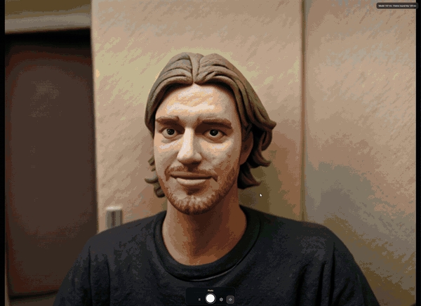
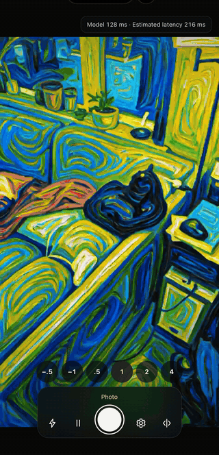

<h1 align="center">Reality Restyling</h1>

Live camera restyling with AI that runs on your PC.

  <a href="https://github.com/marxusss/reality-restyler/releases/latest/download/RealityRestylingSetup.exe"><kbd><strong>↓ Download for Windows</strong></kbd></a>
  &nbsp;·&nbsp;
  <a href="https://github.com/marxusss">GitHub</a>
  &nbsp;·&nbsp;
  <a href="https://www.linkedin.com/in/max-vorwaller-724418259/">LinkedIn</a>
  &nbsp;·&nbsp;
  <a href="https://github.com/marxusss/reality-restyler">Star on GitHub</a>

  
   
  <a href="media/demo.mp4?raw=true">Full desktop demo (MP4)</a>
   
  Demo from the development build on an RTX 5090.
   
  <em>(Note: The GIF encoding has reduced the color range to 95 colors in this demo.)</em>

## Features

- **Live Restyling** — Apply AI styles as you move.
- **Custom Styles** — Save your own prompts and thumbnails.
- **Phone Connection** — Use your phone camera over Tailscale.
- **Style Combiner** — Blend up to five styles.
- **Photo & Video** — Save restyled captures to your device.

## Setup

1. On Windows 11, run `RealityRestylingSetup.exe` and select your model folder or download the files.
2. In **Reality Restyling**, select **Start server**, then **Open app** (or opt to start it when installation finishes).
3. Press **Start** and choose a style.

### Phone

With Tailscale connected on both devices, open the phone link from the Windows launcher in Safari, then tap **Share → Add to Home Screen** to connect from the new icon whenever the PC server is running.

  
   
  <a href="media/phone.mp4?raw=true">Full phone demo (MP4)</a>
   
  <em>(Note: The GIF encoding has reduced the color range to 255 colors in this demo.)</em>

[Phone setup and troubleshooting](docs/setup.md)

## Development

On Windows, run `.\dev.ps1` in a checkout to serve **that checkout** at [localhost:8782](http://127.0.0.1:8782/). It reuses local or installed dependencies; restart after editing. Installed versions continue updating from GitHub releases.

## Hello

I’m Max. I build open source AI apps. I’d appreciate new feature ideas, bug reports, and pull requests for features or fixes.

[Suggest a feature or report a bug](https://github.com/marxusss/reality-restyler/issues/new) · [Pull requests](https://github.com/marxusss/reality-restyler/pulls)

[License and notices](NOTICE.md)
